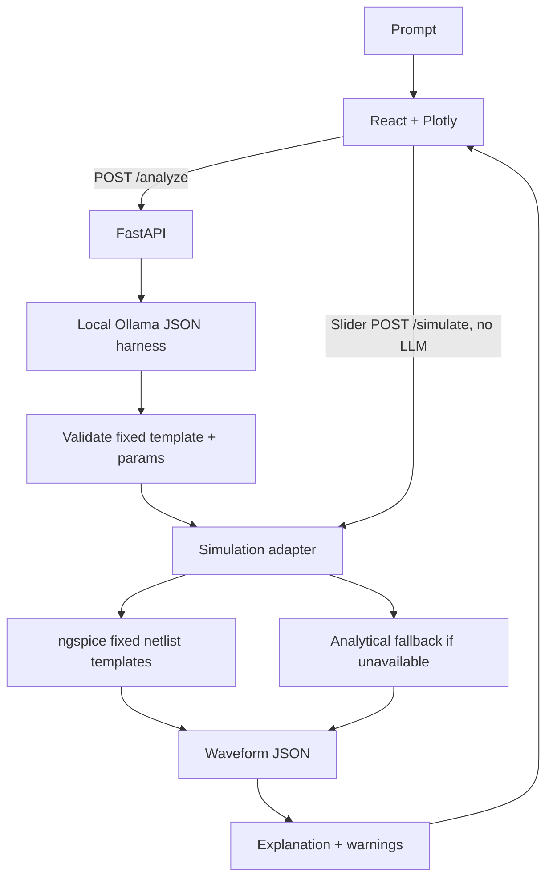

# Circuit Doctor ⚡

**Describe a circuit in plain English. Simulate it. Understand the waveform.**

Hacktober @ NITH · Educational MVP · Local-first AI + SPICE

## What it does
- Supports four fixed templates: RC low-pass, RC high-pass, voltage divider, inverting op-amp.
- Uses a local Ollama instruct model to map prompts to a small JSON object. It never accepts model-written netlists.
- Validates template parameters before simulation.
- Runs ngspice if installed; if unavailable or failing, uses a labelled analytical fallback (never claims fallback is SPICE).
- Returns waveform arrays and a simulation-aware explanation.
- Component sliders call `POST /simulate` directly, without calling the LLM again.
- React/Vite/Plotly frontend, prompt examples, status indicators, errors and warnings.

## Architecture


## Quick start

### Windows 10/11 (recommended)

**Prerequisites:** Python 3.11+ and Node.js LTS. Install Python from [python.org](https://www.python.org/downloads/windows/) and enable **Add Python to PATH** in the installer. Install Node.js LTS from [nodejs.org](https://nodejs.org/); npm is included.

1. Extract the ZIP to a normal folder, for example `C:\Users\YourName\Projects\hacktober` (avoid `Program Files` and OneDrive-synced folders while debugging).
2. Double-click **`setup_windows.bat`**. It creates `backend\.venv`, installs Python packages, and runs `npm install` in the frontend.
3. Double-click **`start_windows.bat`**. Two terminal windows should open: the FastAPI backend and Vite frontend.
4. Open **http://127.0.0.1:5173**. API documentation is at **http://127.0.0.1:8000/docs**.
5. To stop the app, close both terminal windows. To restart later, you only need `start_windows.bat`.

If a script reports an error, run it from Command Prompt so the message stays visible. Do not run as Administrator; elevated permissions should not be required.

#### Optional: local AI and actual SPICE

- Install [Ollama for Windows](https://ollama.com/download/windows), then open PowerShell and run `ollama pull qwen2.5:3b-instruct`. Keep Ollama running. The backend uses this local model when reachable; otherwise it uses a deterministic, clearly disclosed fallback parser. If you use a different model, set `OLLAMA_MODEL` in the environment before starting the backend.
- Install a Windows build of ngspice and add the folder containing `ngspice.exe` to your user `PATH`. Open a **new** terminal and verify with `ngspice --version`. If ngspice is absent or fails, the app uses its labelled analytical fallback instead; do not present that as an SPICE result.

### Manual start (Windows PowerShell)

From the extracted repository root, use two terminals.

Backend terminal:
```powershell
cd backend
py -3 -m venv .venv
.\.venv\Scripts\python.exe -m pip install -r requirements.txt
.\.venv\Scripts\python.exe -m uvicorn app.main:app --reload --host 127.0.0.1 --port 8000
```

Frontend terminal:
```powershell
cd frontend
npm install
npm run dev
```

### macOS/Linux

Python 3.10+, Node.js 18+, npm. For actual SPICE simulation install `ngspice`; Ollama is recommended for local model mapping.

```bash
# Terminal 1: backend
cd backend
python3 -m venv .venv
source .venv/bin/activate
pip install -r requirements.txt
uvicorn app.main:app --reload --host 127.0.0.1 --port 8000

# Terminal 2: frontend
cd frontend
npm install
npm run dev
```

### Tests and CLI

Run from the repository root after dependencies are installed:

```powershell
backend\.venv\Scripts\python.exe -m pytest -q backend\tests
backend\.venv\Scripts\python.exe scripts\simulate.py --template rc_lowpass --params '{"R":1000,"C":1e-7,"Vin":5}'
```

## API contract
`POST /analyze`
```json
{"prompt":"RC low-pass filter with R=1k and C=100nF"}
```
Returns `template`, validated `params`, `waveform` (`time`, `input`, `output`, `unit`, `source`), `explanation`, and `warnings`.

`POST /simulate`
```json
{"template":"rc_lowpass","params":{"R":2200,"C":1e-7,"Vin":5}}
```
Revalidates parameters and simulates without the LLM. `GET /health` reports API, Ollama and ngspice availability.

## Harness and trust boundaries
1. Request JSON-only output from local Ollama at `/api/generate`.
2. Parse JSON; reject unsupported templates and non-object params.
3. Retry once after malformed output.
4. Validate parameter names, numeric types, finite values and sensible bounds.
5. Build netlists only from fixed templates and validated numeric values.
6. If Ollama fails, deterministic keyword mapping keeps the demo usable and reports that fallback in warnings.

## Agent skill
`circuit-simulator/SKILL.md` contains YAML frontmatter and safe-use instructions. If the `skills-ref` CLI is installed, validate with:
```bash
skills-ref validate ./circuit-simulator
```
CLI availability and syntax can vary by version.

## Supported templates and limitations
| Template | Parameters | Concept |
|---|---|---|
| `rc_lowpass` | R (Ω), C (F), Vin (V) | Attenuates higher frequencies |
| `rc_highpass` | R (Ω), C (F), Vin (V) | Attenuates lower frequencies |
| `voltage_divider` | R1, R2 (Ω), Vin (V) | Output ratio R2/(R1+R2) |
| `inverting_opamp` | Rin, Rf (Ω), Vin (V) | Ideal gain -Rf/Rin, educational ±12 V clipping |

- Stimulus is a 1 kHz sine wave over 10 ms.
- The op-amp uses an idealized behavioral model, not a vendor model.
- A loaded divider, real op-amp bandwidth/saturation, tolerances, parasitics and component power ratings are not fully modeled.
- This is an educational demonstrator, not safety-critical design verification.
- No auth, database, arbitrary netlists or remote closed-model APIs in the core path.
- The UI is for local development; production deployment would need additional security and operational hardening.

## Demo plan (60–90 seconds)
1. Enter “RC low-pass filter with R=1k and C=100nF”.
2. Show selected template, waveform and cutoff-frequency explanation.
3. Move R slider; waveform updates without another LLM call.
4. Try a voltage divider prompt.
5. Show status badges and honestly distinguish ngspice from analytical fallback.

## Hackathon pitch
**Innovation:** natural language connects to an actual simulation path instead of letting AI invent results.  
**Execution:** constrained templates, local inference, validated parameters and interactive plots.  
**Open source:** application code is MIT-licensed; model weights keep their own terms.  
**Impact:** makes basic analog electronics easier to explore while surfacing assumptions.

## Contributing
Fork, create a focused branch, add tests for behavior changes, and preserve the API contract unless the team agrees to change it. Never execute netlists or code supplied by a user/model.

## License
MIT — see [LICENSE](LICENSE).
